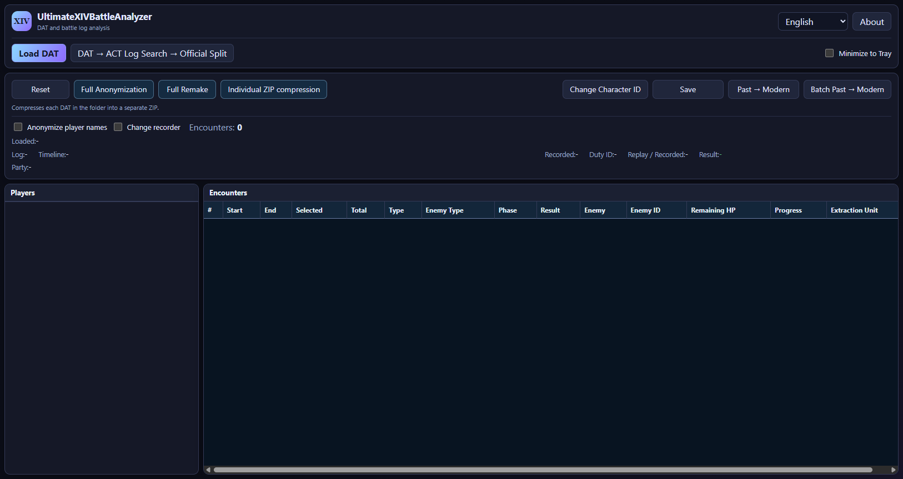

# UltimateXIVBattleAnalyzer

[日本語](README.md) · [Download](https://github.com/Lu-ci-el/UltimateXIVBattleAnalyzer/releases/tag/v3.7.5.6) · [User guide](docs/USER_GUIDE.en.md)

A Windows app for FFXIV replay DAT files. Inspect battles and party composition, extract a battle, anonymize a replay for sharing, change its recorder, and find the ACT logs that match a recording.

## Getting started

1. Download the application ZIP from the [release page](https://github.com/Lu-ci-el/UltimateXIVBattleAnalyzer/releases/tag/v3.7.5.6).
2. Extract the entire folder and run `UltimateXIVBattleAnalyzer.exe`.
3. Choose **Load DAT** and select a recording.
4. Inspect the battle list, choose the operation you need, and save to a separate file.

For 64-bit Windows 10 or 11. If required at startup, install the [.NET 8 Desktop Runtime for Windows x64](https://dotnet.microsoft.com/en-us/download/dotnet/8.0) and [WebView2 Runtime](https://developer.microsoft.com/en-us/microsoft-edge/webview2/). Keep the app with all its included folders. The required dictionary is included.

## Features

| Feature | What it does |
| --- | --- |
| Inspect a DAT | Display recording information, party members, and battles from a supported DAT or ZIP containing one DAT. |
| Extract a battle | Save a selected battle as a separate DAT or ZIP. |
| Anonymize names | Change names, character identifiers, home-world information, and the internal recording date for sharing. |
| Full anonymization | Also change appearance, including race, gender, height, and outfit. |
| Change recorder | Select a party member as the recorder and save. This also works with an anonymized DAT. |
| Past → Modern | Convert supported older DATs to the modern generation supported by the app. |
| Batch Past → Modern | Convert supported DATs in a selected folder and its subfolders to a separate output folder. |
| Extract ACT logs | Match an original DAT with existing ACT logs and extract the relevant portion. |
| Individual ZIP compression | Archive supported older DATs as one ZIP per recording, keeping the originals. |

Anonymized names inside the DAT use full English job names such as `Paladin`. The app displays labels such as `Player 01` to distinguish people, including members with the same job.

When you open an anonymized DAT, **changing the recorder is the only permitted editing operation**. Extract battles and choose appearance settings before anonymizing the original DAT. Keep the original if you may want to make different edits later.

Availability depends on the recording generation and contents. Names that cannot be resolved appear as Player numbers. A person cannot be selected as recorder when the required identity information is missing. Successful conversion or extraction does not guarantee identical playback for every replay. Check the saved result before sharing it. Full Remake is in development.

## Help and feedback

- [English user guide](docs/USER_GUIDE.en.md)
- [日本語操作ガイド](docs/USER_GUIDE.ja.md)
- [Report a bug](https://github.com/Lu-ci-el/UltimateXIVBattleAnalyzer/issues/new/choose)
- [Questions and discussions](https://github.com/Lu-ci-el/UltimateXIVBattleAnalyzer/discussions)

Include the app version, steps, expected result, actual result, and exact error text. Hide names, servers, dates, and personal paths in screenshots. Do not attach DATs or ACT logs to public posts. See the [reporting and file sharing guide](https://github.com/Lu-ci-el/UltimateXIVBattleAnalyzer/blob/main/.github/SUPPORT.md#english).

Anonymization cannot guarantee that nobody can recognize a player: party composition, movement, and tactics can still offer clues. Anonymizing a DAT does not anonymize ACT logs.

## Support development

Development and testing cost time and money. I can fund updates myself through December 2026. Updates from January 2027 onward, including 8.0 support, will depend on contributions from people who find the app useful. If it helps you, please consider supporting it at a level that works for you.

[Ko-fi](https://ko-fi.com/lost2) · [OFUSE](https://ofuse.me/lost) · [About supporting development](docs/SUPPORT.en.md)

A donation is not required to report a problem or ask a question. Reports and donations do not guarantee a fix, priority, or a deadline.

The application is distributed through Releases. This repository contains documentation and download information.
