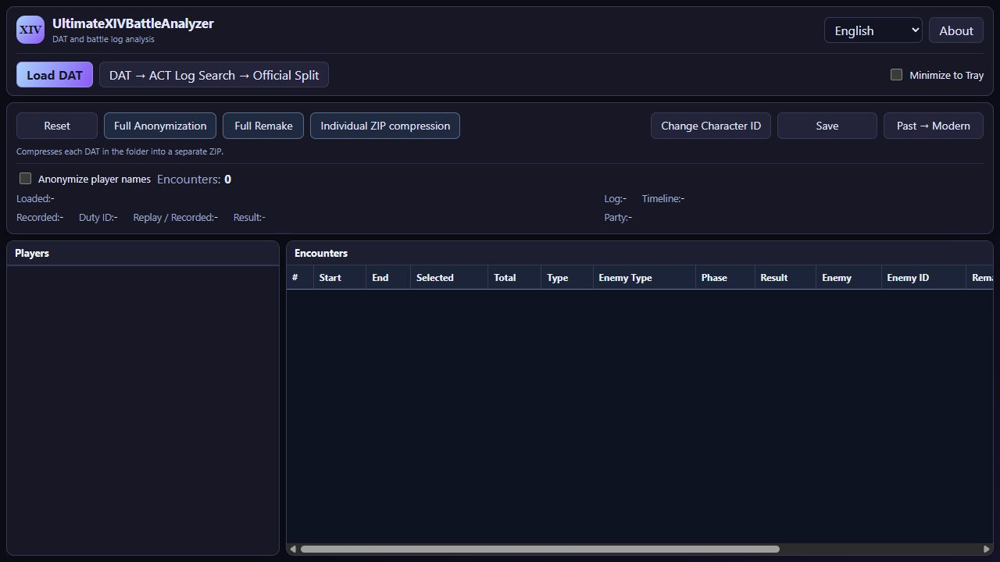

# UltimateXIVBattleAnalyzer

[Download 3.7.4.5](https://github.com/Lu-ci-el/UltimateXIVBattleAnalyzer/releases/tag/v3.7.4.5) · [Release notes](docs/CHANGELOG.en.md)

[日本語](README.md) · [Illustrated guide](docs/USER_GUIDE.en.md) · [Support development](docs/SUPPORT.en.md)

A Windows app for working with FFXIV replay DAT files: inspect battles and party composition, extract a battle, anonymize a replay, and find the ACT logs that match a recording.

## What you can do

- **Read replay DATs**  
  Open recordings from supported generations.  
  View duty information, battles, timings, and party composition.

- **Find and split ACT logs**  
  Choose a DAT and the folder containing your ACT logs.  
  Extract the matching logs for upload to FF Logs.

- **Anonymize names**  
  Replace names in modern DATs with aliases such as `Player 01`.  
  Character identifiers, home-world information, and the internal recording date are also changed for sharing.

- **Full anonymization**  
  Change appearance as well as names and identifiers.  
  Select race, gender, height, and outfit in the anonymization settings.

- **Extract a battle**  
  Select an extractable battle in the list.  
  Save that battle as a separate DAT or ZIP.

- **Past → Modern conversion**  
  Convert supported older DATs to the modern generation handled by the app.  
  Availability depends on the recording generation.

- **Change character ID**  
  Use your own DAT as a reference to change the character ID in another replay.  
  This can improve party-list presentation, such as missing entries.

- **Individual ZIP compression**  
  Archive supported older DATs as one ZIP per recording in a separate folder.  
  The original DATs are kept.

Full Remake is in development.  
Further work depends on support for the project.

From 3.7.4.3, open a saved DAT to check its conversion, anonymization, and battle-extraction history together with the UXBA versions that performed those operations.  
See [processing history](docs/USER_GUIDE.en.md#10-check-a-dats-processing-history).

## Getting started

1. Download the application ZIP from Releases and extract the whole folder.

2. Run `UltimateXIVBattleAnalyzer.exe`.

3. Choose **Load DAT** and select a recording.

4. Inspect its battles, then extract, anonymize, or save as needed.

If required at startup, install the [.NET 8 Desktop Runtime for Windows x64](https://dotnet.microsoft.com/en-us/download/dotnet/8.0) and [WebView2 Runtime](https://developer.microsoft.com/en-us/microsoft-edge/webview2/).  
Keep the app together with its included files.

The [illustrated guide](docs/USER_GUIDE.en.md) covers each workflow.  
Anonymization cannot guarantee that nobody can recognize a player: movement, tactics, and party composition may still offer clues.  
Anonymizing a DAT does not anonymize ACT logs.

## Bugs and questions

Use [bug reports](https://github.com/Lu-ci-el/UltimateXIVBattleAnalyzer/issues/new/choose) for reproducible bugs or unsupported DATs, and [Discussions](https://github.com/Lu-ci-el/UltimateXIVBattleAnalyzer/discussions) for questions or feature ideas.  
Please include the app version, steps, expected behavior, actual behavior, and the exact error text.  
Hide names, servers, recording dates, and personal folder names in screenshots.  
Do not attach DATs or ACT logs to public posts.  
There is currently no private inbox for original DATs, so please start by reporting symptoms and error messages.  
See the [reporting and file sharing guide](https://github.com/Lu-ci-el/UltimateXIVBattleAnalyzer/blob/main/.github/SUPPORT.md#english) for details.

Investigation, fixes, and support for additional DAT formats depend on funding and available development time.  
Some problems may remain unresolved, but a donation is not required to report a problem or ask a question.  
Reports and donations do not guarantee a fix, priority, or a deadline.

## Help keep development going

Development and testing are expensive to sustain.  
I can fund updates myself through December 2026.  
Updates from January 2027 onward, including 8.0 support, will depend on contributions from people who find the app useful.  
If it helps you, please consider supporting it at a level that works for you.

[Support on Ko-fi](https://ko-fi.com/lost2) · [Support on OFUSE](https://ofuse.me/lost)

The app is distributed through Releases.  
This repository contains documentation and download information; it does not include the application's source code.
