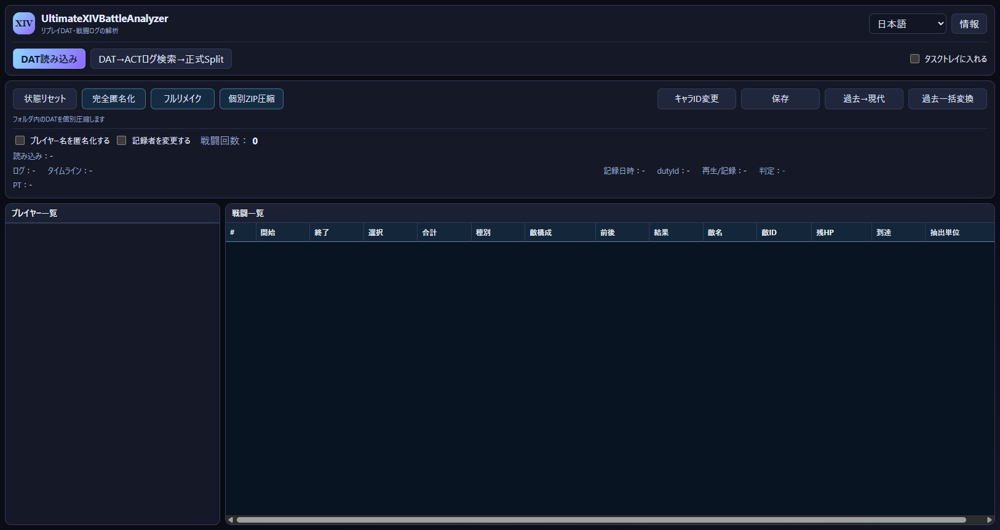

# UltimateXIVBattleAnalyzer

[English](README.en.md) · [ダウンロード](https://github.com/Lu-ci-el/UltimateXIVBattleAnalyzer/releases/tag/v3.7.5.9) · [操作ガイド](docs/USER_GUIDE.ja.md)

FFXIVのリプレイDATを開き、戦闘一覧やパーティ構成を確認できるWindows用アプリです。見返したい戦闘の取り出し、共有用の匿名化、記録者の変更、対応するACTログの抽出に使えます。

## 使い始める

1. [配布ページ](https://github.com/Lu-ci-el/UltimateXIVBattleAnalyzer/releases/tag/v3.7.5.9)からアプリのZIPをダウンロードします。
2. ZIPをフォルダごと展開し、`UltimateXIVBattleAnalyzer.exe`を起動します。
3. 「DAT読み込み」で録画を選びます。
4. 戦闘一覧を確認し、目的の操作を行って別のファイルへ保存します。

Windows 10／11の64ビット環境向けです。起動に必要な場合は [.NET 8 Desktop Runtime（Windows x64）](https://dotnet.microsoft.com/en-us/download/dotnet/8.0) と [WebView2 Runtime](https://developer.microsoft.com/en-us/microsoft-edge/webview2/) を導入してください。アプリは同梱フォルダと一緒に使います。辞書も同梱されています。

## 主な機能

| 機能 | できること |
| --- | --- |
| DATの確認 | 対応するDAT／DATを1本含むZIPから、録画情報・パーティ・戦闘一覧を表示します。 |
| 戦闘区間の抽出 | 選んだ戦闘を別のDATまたはZIPへ保存します。 |
| 名前の匿名化 | 名前・キャラクター識別情報・所属サーバー情報・内部の撮影日時を共有用に変更します。 |
| 完全匿名化 | 名前の匿名化に加えて、種族・性別・身長・衣装などの見た目を変更します。 |
| 記録者変更 | パーティメンバーから記録者を選んで保存します。匿名化後のDATでも変更できます。 |
| 過去→現代 | 対応する過去世代のDATを、アプリが対応する現代世代へ変換します。 |
| 過去一括変換 | 入力・出力フォルダを選び、サブフォルダ内の対応DATをまとめて変換します。 |
| ACTログの抽出 | 元DATと録画時のACTログを照合し、対応するログを取り出します。 |
| 個別ZIP圧縮 | 対応する過去DATを1本ずつZIPに整理します。元DATは残ります。 |

DAT内の匿名名には `Paladin` などの正式な英語ジョブ名を使い、アプリの画面では `Player 01` のような番号で人物を区別します。同じジョブが複数いても別の人物として扱います。

匿名化済みDATを開いた場合、加工できる操作は**記録者変更だけ**です。戦闘の抽出や見た目の設定は、匿名化する前に元DATで行ってください。元DATは保管しておくとやり直せます。

対応状況はDATの世代と記録内容によって異なります。名前が分からない記録はPlayer番号で表示します。人物の識別情報が不足している場合は、記録者として選べません。変換・抽出に成功しても、すべてのリプレイで同じ再生結果を保証するものではありません。共有前に保存結果を確認してください。フルリメイクは開発中です。

## 操作方法と問い合わせ

- [日本語操作ガイド](docs/USER_GUIDE.ja.md)
- [English user guide](docs/USER_GUIDE.en.md)
- [不具合報告](https://github.com/Lu-ci-el/UltimateXIVBattleAnalyzer/issues/new/choose)
- [使い方の質問・相談](https://github.com/Lu-ci-el/UltimateXIVBattleAnalyzer/discussions)

報告にはアプリの版、操作手順、期待した結果、実際の結果とエラー文を添えてください。画像の名前・サーバー・日時・個人パスを隠し、DATやACTログを公開投稿へ添付しないでください。[報告・ファイル提供の案内](https://github.com/Lu-ci-el/UltimateXIVBattleAnalyzer/blob/main/.github/SUPPORT.md#日本語)も確認してください。

匿名化しても、ジョブ構成や動きなどから人物を推測できる場合があります。また、DATの匿名化はACTログには適用されません。

## 開発を支えてください

開発・検証を続けるには費用がかかります。自費で更新を続けられる見込みは2026年12月までで、2027年1月以降の更新や8.0対応は、皆さんからの支援に支えられる形になります。使って役に立ったら、無理のない範囲で応援してもらえると助かります。

[Ko-fiで支援する](https://ko-fi.com/lost2) · [OFUSEで支援する](https://ofuse.me/lost) · [開発支援について](docs/SUPPORT.ja.md)

報告や質問に支援は必須ではありません。報告・支援によって修正、優先対応、期限をお約束するものではありません。

アプリ本体はReleasesで配布します。このリポジトリには説明書と配布案内を置いています。
