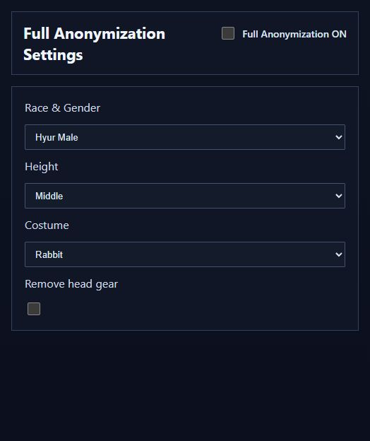

# UXBA User Guide

[Home](../README.en.md) · [日本語](USER_GUIDE.ja.md)

## Before you start

Extract the distribution ZIP and run `UltimateXIVBattleAnalyzer.exe`.  
Keep the included folders together; do not run the app from inside the ZIP.  
Keep your original DATs and save edited copies under different names.

If prompted at startup, install the [.NET 8 Desktop Runtime for Windows x64](https://dotnet.microsoft.com/en-us/download/dotnet/8.0) and [WebView2 Runtime](https://developer.microsoft.com/en-us/microsoft-edge/webview2/).

## 1. Open a DAT and inspect its battles and party

1. Click **Load DAT** and select a replay file.
2. Check the recording information and party area at the top.
3. Browse start and end times, duration, battle type, result, enemy name, and enemy ID.  
   Scroll horizontally to see columns that do not fit on screen.

Use the selector at the top right to switch between Japanese and English.  
You can also open a supported ZIP containing a single DAT.

The app can read supported recordings from different generations.  
Reading, conversion, and anonymization each have their own supported range; being able to open a DAT does not make every editing operation available for it.

## 2. Find and extract the matching ACT logs

You need the ACT logs recorded at the time of the replay.  
This feature does not create ACT logs from a DAT.

1. Click the **DAT → ACT Log Search → Official Split** control.
2. Select the DAT for this operation, even if you already have it open.
3. Select the folder containing your ACT logs.  
   The search includes subfolders and supported log ZIPs.
4. Choose an output folder.
5. When extraction finishes, check the output logs and upload them using the FF Logs uploader.

Use the original DAT for this search when possible: matching uses the recording date and time, which anonymization changes.  
Anonymizing a DAT does not change names in ACT logs.  
Check the visibility settings on FF Logs before sharing.

## 3. Anonymize names and save

This operation is for modern DATs.  
For an older recording, use **Past → Modern** first if its generation is supported.

1. Open the target DAT.
2. Enable **Anonymize player names**.
3. Click **Save**, then choose the output location and format.
4. Open the saved DAT and check it before sharing.

To anonymize the whole recording, save without a battle row selected.  
If a row is selected, the app prompts you to extract that battle instead.

Names become aliases such as `Player 01` and `Player 02`.  
This applies to the supported player records in the DAT, including players other than the recorder.  
It changes the character identifiers and home-world information stored inside the DAT as well as the displayed names.  
Home worlds are replaced with an anonymous virtual world, and the internal recording date is replaced with a fixed value.  
If the filename itself contains a name or recording date, check that too before sharing.

Name anonymization keeps the characters' appearance.  
Use full anonymization to change it as well.

## 4. Change appearance with full anonymization

1. Click **Full Anonymization** to open its settings.
2. Enable **Full Anonymization ON**.
3. Select race and gender, height, and outfit.  
   Removing headgear is available for supported combinations.
4. Close the settings window, check that **Anonymize player names** is enabled on the main screen, and click **Save**.

Choosing settings does not edit the original DAT.  
The changes are applied to the saved file.  
Along with names and identifiers, the characters' appearance is changed for sharing.

Even full anonymization cannot make recognition impossible.  
Party composition, movement, and tactics can still provide clues.  
Review the result before sharing it.

## 5. Extract a battle into a separate file

This operation uses modern DATs.  
Convert a supported older recording with **Past → Modern** first.

1. Open a DAT and select the battle interval you want in the list.
2. Click **Save**.
3. Review the extraction prompt, then choose the output location and DAT or ZIP format.

Extractable intervals depend on the recording and the battles the app recognizes.  
With no battle selected, saving uses the loaded DAT as a whole.  
If you also want anonymization, set it before saving.

## 6. Convert an older DAT to a modern generation

Choose **Past → Modern**, select the recording, and follow the prompts to create a separate output.  
This works for supported recording generations.  
You can then load the converted DAT for operations intended for modern recordings.

Availability depends on the recording generation.  
If conversion is unavailable, include the exact error message and recording generation when reporting it.

## 7. Change character ID to improve party-list display

This feature can improve missing party entries and similar presentation issues when replaying a DAT recorded by someone else.  
Prepare a DAT recorded with your own character to use as the reference.

1. Load the target DAT you want to change.
2. Click **Change Character ID**.
3. Select your own reference DAT.
4. Save a separate copy in the current replay folder shown by the save dialog.  
   The suggested filename begins with `CHARACTER_ID_`.
5. Use the saved DAT for replay.

Check that you selected the intended reference and target.  
Changing character ID is separate from Full Remake; it does not rebuild race, equipment, or battle content.

## 8. Organize older DATs as individual ZIPs

1. Click **Individual ZIP compression**.
2. Choose the input folder containing your original DATs.
3. Choose a separate output folder.  
   It cannot be the input folder, a folder inside it, or one of its parent folders.
4. Confirm the operation.  
   Each eligible DAT is archived in its own ZIP and organized by generation, duty, and other recording details.

Original DATs are kept in place and left unchanged.  
Current-generation recordings are excluded; this tool organizes supported older recordings.  
Matching existing archives are skipped, while different recordings with the same filename are saved under separate names.  
Compression does not anonymize a recording.

## 9. Full Remake and support

Full Remake is in development.  
The distribution version displays an information message.  
See [support development](SUPPORT.en.md) if you would like to help fund further work.

## 10. Check a DAT's processing history

Normal saves from version 3.7.4.3 onward record the UXBA version and processing operations inside the DAT.  
Open the saved file to see the following information below its filename:

- The UXBA version that last saved the file
- Past-to-modern conversion, anonymization, appearance anonymization, and battle extraction, with the version used for each operation
- Character ID changes

For example: `UXBA 3.7.4.3 saved · Past to modern 3.7.4.3 / Anonymized 3.7.4.3 / Battle extracted 3.7.4.3`

The marker survives renaming and ZIP packaging.  
Further processing in UXBA retains the existing history.  
It does not store character names, the original file path, or the recording date.

“No UXBA marker (processing history unknown)” does not certify an original recording.  
Files processed by older versions may also lack a marker.  
The marker describes processing history; it does not authenticate the creator or guarantee anonymity.  
UXBA stops loading and shows an error if the file and marker no longer match.

## Troubleshooting

If the app will not start, check that you extracted the whole ZIP and installed any requested runtime.  
If loading or conversion stops, keep the exact error text.

A useful bug report includes the app version, steps, expected behavior, and actual behavior.  
Hide character names, servers, dates, and personal paths in screenshots.  
Do not attach DATs or ACT logs directly to public posts.
