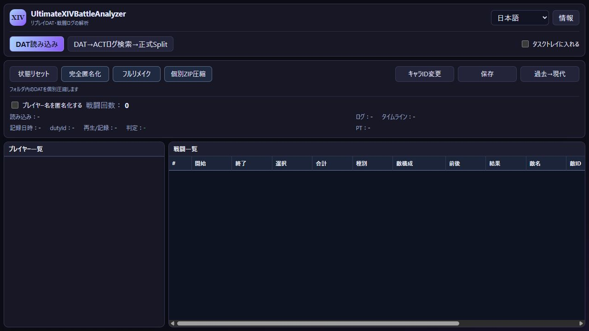
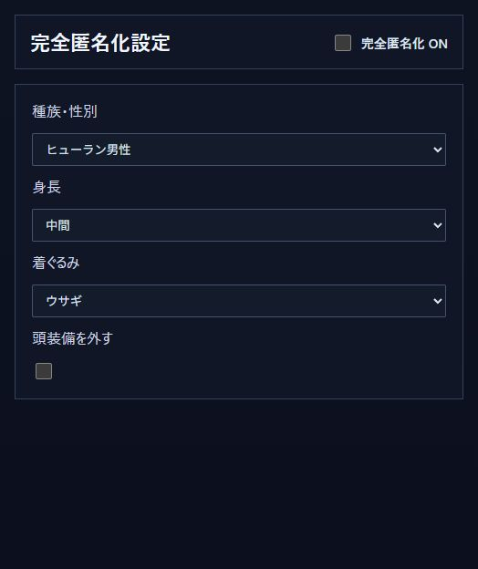

# UXBA 操作ガイド

[トップへ](../README.md) · [English](USER_GUIDE.en.md)

## 起動の準備

配布ZIPを展開し、`UltimateXIVBattleAnalyzer.exe`を起動します。  
ZIPの中から直接起動せず、同梱フォルダも一緒に展開してください。  
元のDATは保管し、編集したものは別の名前で保存すると使い分けやすくなります。

起動時に必要と表示された場合は [.NET 8 Desktop Runtime（Windows x64）](https://dotnet.microsoft.com/en-us/download/dotnet/8.0) と [WebView2 Runtime](https://developer.microsoft.com/en-us/microsoft-edge/webview2/) を導入します。

## 1. DATを開いて戦闘とパーティを見る

1. 「DAT読み込み」を押し、リプレイDATを選びます。
2. 上部の録画情報とパーティ欄を確認します。
3. 戦闘一覧で、開始・終了、戦闘時間、種別、結果、敵名・敵IDなどを確認します。  
   横に収まらない列はスクロールして見られます。

画面右上で日本語と英語を切り替えられます。  
DATを1本収めた対応ZIPも読み込めます。

異なる世代の録画も、対応するデータであれば読み込めます。  
読み込み・現代への変換・匿名化はそれぞれ対応条件があるため、読み込めるDATがすべて編集できるわけではありません。

## 2. DATに対応するACTログを取り出す

この機能には、録画したときのACTログが必要です。  
DATからACTログを新しく生成する機能ではありません。

1. 「DAT→ACTログ検索→正式Split」を押します。
2. 対象のDATを選びます。  
   すでに開いていても、この操作で対象を選択します。
3. ACTログを保管しているフォルダを選びます。  
   サブフォルダ内のログや、対応するログZIPも検索対象になります。
4. 抽出結果の保存先を選びます。
5. 完了後、出力されたログを確認し、FF Logsのアップローダーでアップロードします。

録画日時を使って照合するため、ログを探すときは匿名化前の元DATを使うのがおすすめです。  
DATの匿名化を行ってもACTログの名前などは変わりません。  
公開範囲はFF Logs側でも確認してください。

## 3. 名前を匿名化して保存する

現代DATを対象にします。  
過去のDATでは、対応している場合に先に「過去→現代」を行ってください。

1. 対象DATを開きます。
2. 「プレイヤー名を匿名化する」を有効にします。
3. 「保存」を押し、出力先と形式を選びます。
4. 保存したDATを開いて、共有したい内容になっているか確認します。

録画全体を匿名化したい場合は、戦闘行を選択せずに保存します。  
行を選んだ状態では、その戦闘の区間抽出として確認画面が出ます。

名前は `Player 01`、`Player 02` のような表記になります。  
記録者だけを隠す機能ではなく、DAT内の対応するプレイヤーが対象です。  
画面の表示名だけでなく、DAT内部のキャラクター識別情報と所属サーバー情報も変更します。  
所属サーバーは匿名用の仮想サーバーに、内部の撮影日時は固定値に置き換えます。  
元ファイル名に日時や名前が含まれている場合は、共有するファイルの名前も確認してください。

名前の匿名化だけでは、種族や見た目は変わりません。  
見た目も変更したい場合は、次の完全匿名化を使います。

## 4. 完全匿名化で見た目も変える

1. 「完全匿名化」を押して設定画面を開きます。
2. 「完全匿名化 ON」を有効にします。
3. 種族・性別、身長、着ぐるみを選びます。  
   対応する組み合わせでは頭装備を外す設定も使えます。
4. 設定画面を閉じ、メイン画面の「プレイヤー名を匿名化する」が有効になっていることを確認して「保存」します。

設定を選んだだけでは元DATは変更されません。  
保存したDATに反映されます。  
名前や識別情報に加え、キャラクターの見た目も共有用に変更します。

完全匿名化という名前でも、人物を推測できる可能性をゼロにするものではありません。  
ジョブ構成、動き、攻略方法などから分かる場合があります。  
共有前に内容を確認してください。

## 5. 戦闘区間を別ファイルに取り出す

現代DATで使えます。  
対応する過去DATは、先に「過去→現代」で変換します。

1. DATを開き、戦闘一覧から取り出したい区間を選びます。
2. 「保存」を押します。
3. 区間抽出の確認内容を見て、出力先とDAT／ZIPを選んで保存します。

取り出せる区間は、DATの記録内容と認識された戦闘区間によって決まります。  
何も選ばずに保存すると、読み込んだDAT全体が保存対象になります。  
抽出と匿名化を組み合わせる場合は、保存前に匿名化の設定も確認してください。

## 6. 過去のDATを現代へ変換する

「過去→現代」から対象のDATを選び、画面の案内に従って別ファイルへ出力します。  
録画世代が対応している場合に使える機能です。  
変換後のDATを読み込むと、現代DAT向けの操作へ進めます。

対応状況は録画の世代によって異なります。  
変換できないと表示された場合は、エラー文と録画世代を添えて報告してください。

## 7. キャラIDを変更してPT表示を整える

自分以外が記録したDATを再生するときに、PT一覧の抜けなどの見た目を改善するための機能です。  
参照には自分のキャラクターを記録したDATを用意します。

1. 変更したい対象DATを開きます。
2. 「キャラID変更」を押します。
3. 参照する自分のDATを選びます。
4. 保存画面で、案内された現在のリプレイフォルダ内に別名で保存します。  
   標準のファイル名は `CHARACTER_ID_` で始まります。
5. 保存したDATをリプレイで使用します。

参照DATと対象DATを取り違えないようにしてください。  
キャラID変更は、種族・装備・戦闘内容を作り直すフルリメイクとは別の機能です。

## 8. 過去のDATを個別ZIPに整理する

1. 「個別ZIP圧縮」を押します。
2. 元DATを保管している入力フォルダを選びます。
3. ZIPを保存する別のフォルダを選びます。  
   入力フォルダ自身や、その中・上位のフォルダは指定できません。
4. 確認画面で実行すると、対象DATが1本ずつZIPになり、世代やコンテンツなどで分類されます。

元DATは移動・変更されません。  
現在の世代は対象から除かれ、対応する過去の録画を整理します。  
同じ内容のZIPがある場合は再作成を省き、同名で内容が異なるものは別名で保存します。  
圧縮によって匿名化はされません。

## 9. フルリメイクと開発支援

フルリメイクは開発中です。  
配布版では案内を表示します。  
開発を進めるための支援については[こちら](SUPPORT.ja.md)をご覧ください。

## 困ったとき

起動しない場合は、ZIP全体を展開したか、必要なランタイムが入っているかを確認してください。  
読み込みや変換で止まる場合は、表示されたエラー文をそのまま控えてください。

不具合報告には、アプリのバージョン、操作手順、期待した結果、実際の結果が役立ちます。  
スクリーンショットのキャラクター名・サーバー名・日時・個人パスを隠し、DATやACTログは公開投稿にそのまま添付しないでください。
